# Assistant du site — arbre de conversation

> Fichier généré par `node outils/arbre-chatbot.js` à partir de `chatbot.js`. Ne pas modifier à la main.

**35 étapes · 93 choix · 10 types de demandes de devis.**
Ajoutés automatiquement : « Menu principal » sur chaque étape, et « ← Retour » dès la deuxième étape.
Une demande de devis passe par : nom → téléphone (vérifié) → récapitulatif → envoi par Web3Forms
(même clé que les formulaires, dans `script.js`). En cas d'échec : WhatsApp ou appel.

## Schéma

```mermaid
flowchart LR
  start["<b>start</b><br/>Bonjour et bienvenue chez Sancy & Co."]
  site["<b>site</b><br/>Avec plaisir. Quel est l'objectif principal d…"]
  site_present["<b>site_present</b><br/>Pour présenter votre activité, trois formules…"]
  site_unsure["<b>site_unsure</b><br/>Pas de souci, on va trouver ensemble."]
  site_products["<b>site_products</b><br/>Vos clients doivent-ils pouvoir commander et …"]
  site_catalogue["<b>site_catalogue</b><br/>Bonne approche : un site catalogue présente t…"]
  pack_onepage["<b>pack_onepage</b><br/>Pack One Page — dès 35 000 DA"]
  pack_vitrine["<b>pack_vitrine</b><br/>Pack Vitrine — dès 60 000 DA"]
  pack_entreprise["<b>pack_entreprise</b><br/>Pack Entreprise — dès 100 000 DA · le plus ch…"]
  pack_ecommerce["<b>pack_ecommerce</b><br/>Pack E-commerce — dès 180 000 DA"]
  faq_cod["<b>faq_cod</b><br/>Le client passe commande sur votre site, vous…"]
  app["<b>app</b><br/>Les applications mobiles sont réalisées sur d…"]
  app_clients["<b>app_clients</b><br/>Réservation, commande, fidélité, catalogue… U…"]
  app_team["<b>app_team</b><br/>Suivi des commandes, gestion des stocks, tour…"]
  app_unsure["<b>app_unsure</b><br/>Aucun souci : la première étape est un échang…"]
  ads["<b>ads</b><br/>Sur quelle plateforme souhaitez-vous communiq…"]
  ads_meta["<b>ads_meta</b><br/>Il vous suffit d'une page Facebook ou d'un co…"]
  ads_google["<b>ads_google</b><br/>Avec Google Ads, vous apparaissez en tête des…"]
  ads_unsure["<b>ads_unsure</b><br/>En règle générale : Facebook et Instagram pou…"]
  site_for_ads["<b>site_for_ads</b><br/>Bonne remarque : la publicité attire, le site…"]
  brand["<b>brand</b><br/>Logo, charte graphique, cartes de visite, sup…"]
  brand_new["<b>brand_new</b><br/>Nous créons votre identité de A à Z : logo, p…"]
  brand_refresh["<b>brand_refresh</b><br/>Moderniser un logo sans perdre ce que vos cli…"]
  brand_print["<b>brand_print</b><br/>Cartes de visite, flyers, bannières, kakémono…"]
  seo["<b>seo</b><br/>Le référencement (SEO) permet d'apparaître su…"]
  seo_has["<b>seo_has</b><br/>Nous analysons votre site (vitesse, contenus,…"]
  seo_none["<b>seo_none</b><br/>Nos sites sont pensés pour Google dès le dépa…"]
  prices["<b>prices</b><br/>Voici nos formules de sites web :"]
  faq["<b>faq</b><br/>Bien sûr. Quelle est votre question ?"]
  faq_delay["<b>faq_delay</b><br/>En général, une à deux semaines pour un site …"]
  faq_edit["<b>faq_edit</b><br/>Oui. À partir du pack Vitrine, votre site dis…"]
  faq_hosting["<b>faq_hosting</b><br/>Nous nous occupons de toute la mise en ligne …"]
  faq_why["<b>faq_why</b><br/>Votre page Facebook appartient à la plateform…"]
  faq_process["<b>faq_process</b><br/>Quatre étapes, toujours dans le même ordre :"]
  human["<b>human</b><br/>Notre équipe vous répond directement. Comment…"]
  start -->|"Créer un site internet"| site
  start -->|"Une application mobile"| app
  start -->|"Publicité & réseaux sociaux"| ads
  start -->|"Logo & identité de marque"| brand
  start -->|"Être visible sur Google"| seo
  start -->|"Voir les tarifs"| prices
  start -->|"J'ai une question"| faq
  start -->|"Parler à un conseiller"| human
  site -->|"Présenter mon activité"| site_present
  site -->|"Vendre mes produits en ligne"| pack_ecommerce
  site -->|"Montrer mes produits, sans paieme…"| site_catalogue
  site -->|"Je ne sais pas encore"| site_unsure
  site_present -->|"Une seule page me suffit"| pack_onepage
  site_present -->|"J'ai plusieurs services à présent…"| pack_vitrine
  site_present -->|"Je veux un blog ou plusieurs lang…"| pack_entreprise
  site_unsure -->|"Des produits"| site_products
  site_unsure -->|"Des services"| site_present
  site_unsure -->|"Les deux"| pack_entreprise
  site_products -->|"Oui, je veux une vraie boutique"| pack_ecommerce
  site_products -->|"Non, ils me contactent pour comma…"| site_catalogue
  end0(["Demande envoyée : Site entreprise"])
  site_catalogue -->|"Recevoir un devis gratuit"| end0
  site_catalogue -->|"Plutôt une vraie boutique en ligne"| pack_ecommerce
  end1[/"Page : blog/vitrine-ou-e-commerce.html"/]
  site_catalogue -->|"Lire : vitrine ou e-commerce ?"| end1
  end2(["Demande envoyée : Site One Page"])
  pack_onepage -->|"Recevoir un devis gratuit"| end2
  pack_onepage -->|"Comparer avec le pack Vitrine"| pack_vitrine
  end3(["Demande envoyée : Site vitrine"])
  pack_vitrine -->|"Recevoir un devis gratuit"| end3
  pack_vitrine -->|"Voir le pack Entreprise"| pack_entreprise
  pack_entreprise -->|"Recevoir un devis gratuit"| end0
  pack_entreprise -->|"Voir le pack E-commerce"| pack_ecommerce
  end4(["Demande envoyée : Site e-commerce"])
  pack_ecommerce -->|"Recevoir un devis gratuit"| end4
  pack_ecommerce -->|"Le paiement à la livraison, comme…"| faq_cod
  pack_ecommerce -->|"Lire : vitrine ou e-commerce ?"| end1
  faq_cod -->|"Recevoir un devis e-commerce"| end4
  app -->|"Une application pour mes clients"| app_clients
  app -->|"Un outil pour mon équipe"| app_team
  app -->|"Je ne sais pas encore"| app_unsure
  end5(["Demande envoyée : Application mobile"])
  app_clients -->|"Recevoir un devis gratuit"| end5
  app_clients -->|"En parler à un conseiller"| human
  app_team -->|"Recevoir un devis gratuit"| end5
  app_team -->|"En parler à un conseiller"| human
  app_unsure -->|"Être rappelé"| end5
  end6(("WhatsApp"))
  app_unsure -->|"Discuter sur WhatsApp"| end6
  ads -->|"Facebook & Instagram"| ads_meta
  ads -->|"Google"| ads_google
  ads -->|"Je ne sais pas encore"| ads_unsure
  end7(["Demande envoyée : Publicité Meta / Google"])
  ads_meta -->|"Lancer ma campagne"| end7
  end8[/"Page : blog/publicite-facebook-instagram-algerie.html"/]
  ads_meta -->|"Lire notre guide"| end8
  ads_meta -->|"Je n'ai pas encore de site"| site_for_ads
  ads_google -->|"Lancer ma campagne"| end7
  ads_google -->|"Je n'ai pas encore de site"| site_for_ads
  ads_unsure -->|"Être conseillé gratuitement"| end7
  ads_unsure -->|"Lire notre guide"| end8
  site_for_ads -->|"Voir le pack One Page"| pack_onepage
  end9(["Demande envoyée : Site + publicité"])
  site_for_ads -->|"Un devis site + publicité"| end9
  brand -->|"Je pars de zéro"| brand_new
  brand -->|"J'ai un logo à moderniser"| brand_refresh
  brand -->|"J'ai besoin de supports (cartes, …"| brand_print
  end10(["Demande envoyée : Identité de marque"])
  brand_new -->|"Recevoir un devis gratuit"| end10
  brand_refresh -->|"Envoyer mon logo sur WhatsApp"| end6
  brand_refresh -->|"Recevoir un devis gratuit"| end10
  brand_print -->|"Recevoir un devis gratuit"| end10
  seo -->|"Oui, j'ai déjà un site"| seo_has
  seo -->|"Non, pas encore"| seo_none
  end11(["Demande envoyée : Référencement SEO"])
  seo_has -->|"Demander un audit gratuit"| end11
  seo_none -->|"Voir le pack Vitrine"| pack_vitrine
  seo_none -->|"Recevoir un devis gratuit"| end11
  prices -->|"One Page"| pack_onepage
  prices -->|"Vitrine"| pack_vitrine
  prices -->|"Entreprise"| pack_entreprise
  prices -->|"E-commerce"| pack_ecommerce
  end12(["Demande envoyée : Autre / je ne sais pas encore"])
  prices -->|"Un devis personnalisé"| end12
  end13[/"Page : index.html#tarifs"/]
  prices -->|"Voir la page des tarifs"| end13
  faq -->|"Quels sont les délais ?"| faq_delay
  faq -->|"Pourrai-je modifier mon site moi-…"| faq_edit
  faq -->|"L'hébergement et le domaine sont-…"| faq_hosting
  faq -->|"Pourquoi un site plutôt qu'une pa…"| faq_why
  faq -->|"Comment se déroule un projet ?"| faq_process
  faq -->|"Une autre question"| human
  faq_delay -->|"Une autre question"| faq
  faq_delay -->|"Recevoir un devis gratuit"| end12
  faq_edit -->|"Une autre question"| faq
  faq_edit -->|"Voir le pack Vitrine"| pack_vitrine
  faq_hosting -->|"Une autre question"| faq
  faq_hosting -->|"Recevoir un devis gratuit"| end12
  faq_why -->|"Une autre question"| faq
  faq_why -->|"Voir les formules de sites"| site_present
  end14[/"Page : blog/site-web-entreprise-algerie.html"/]
  faq_why -->|"Lire l'article complet"| end14
  faq_process -->|"Une autre question"| faq
  faq_process -->|"Démarrer mon projet"| end12
  human -->|"Discuter sur WhatsApp"| end6
  end15(("Appel 0781051893"))
  human -->|"Appeler le 07 81 05 18 93"| end15
  end16(("Appel 0558265352"))
  human -->|"Appeler le 05 58 26 53 52"| end16
  human -->|"Être rappelé"| end12
  classDef endpoint fill:#D9BE82,stroke:#8A6A2F,color:#0A0A0A;
  class end0,end1,end2,end3,end4,end5,end6,end7,end8,end9,end10,end11,end12,end13,end14,end15,end16 endpoint;
```

## Arbre détaillé

- **start** — Bonjour et bienvenue chez Sancy & Co. / Je suis l'assistant du studio. Dites-moi ce qui vous amène, je vous oriente en quelques clics.
  - « Créer un site internet » →
    - **site** — Avec plaisir. Quel est l'objectif principal de votre site ?
      - « Présenter mon activité » →
        - **site_present** — Pour présenter votre activité, trois formules : / • One Page — une page élégante, dès 35 000 DA • Vitrine — plusieurs pages, dès 60 000 DA • Entreprise — avec blog et multilingue, dès 100 000 DA / Qu'est-ce qui vous correspond le mieux ?
          - « Une seule page me suffit » →
            - **pack_onepage** — Pack One Page — dès 35 000 DA / Une page élégante et complète, un design sur-mesure adapté au mobile, un formulaire de contact, un bouton WhatsApp et la mise en ligne incluse. / Délai habituel : une à deux semaines.
              - « Recevoir un devis gratuit » → ✉ nom + téléphone, demande envoyée (service : Site One Page)
              - « Comparer avec le pack Vitrine » →
                - **pack_vitrine** — Pack Vitrine — dès 60 000 DA / Pages illimitées, design sur-mesure adapté au mobile, espace d'administration pour modifier vos contenus, présentation de vos services et référencement de base. / Délai habituel : une à deux semaines.
                  - « Recevoir un devis gratuit » → ✉ nom + téléphone, demande envoyée (service : Site vitrine)
                  - « Voir le pack Entreprise » →
                    - **pack_entreprise** — Pack Entreprise — dès 100 000 DA · le plus choisi / Tout le pack Vitrine, plus un blog, un catalogue avec catégories, un site multilingue (FR / AR / EN) et une formation à l'administration.
                      - « Recevoir un devis gratuit » → ✉ nom + téléphone, demande envoyée (service : Site entreprise)
                      - « Voir le pack E-commerce » →
                        - **pack_ecommerce** — Pack E-commerce — dès 180 000 DA / Produits illimités, panier et gestion des commandes, espace client, paiement à la livraison et tableau de bord des ventes. / Délai habituel : trois à six semaines, selon le nombre de produits.
                          - « Recevoir un devis gratuit » → ✉ nom + téléphone, demande envoyée (service : Site e-commerce)
                          - « Le paiement à la livraison, comment ça marche ? » →
                            - **faq_cod** — Le client passe commande sur votre site, vous la retrouvez dans votre tableau de bord, et il paie à la réception du colis. / C'est le mode de paiement le plus rassurant pour les acheteurs en Algérie. La livraison est assurée par le prestataire de votre choix.
                              - « Recevoir un devis e-commerce » → ✉ nom + téléphone, demande envoyée (service : Site e-commerce)
                          - « Lire : vitrine ou e-commerce ? » → page `blog/vitrine-ou-e-commerce.html`
          - « J'ai plusieurs services à présenter » →
            - ↺ *pack_vitrine (déjà détaillé plus haut)*
          - « Je veux un blog ou plusieurs langues » →
            - ↺ *pack_entreprise (déjà détaillé plus haut)*
      - « Vendre mes produits en ligne » →
        - ↺ *pack_ecommerce (déjà détaillé plus haut)*
      - « Montrer mes produits, sans paiement en ligne » →
        - **site_catalogue** — Bonne approche : un site catalogue présente toute votre gamme (photos, descriptions, prix) et vos clients commandent par téléphone ou WhatsApp. / C'est inclus dans notre pack Entreprise, dès 100 000 DA. Et il pourra évoluer en boutique en ligne plus tard.
          - « Recevoir un devis gratuit » → ✉ nom + téléphone, demande envoyée (service : Site entreprise)
          - « Plutôt une vraie boutique en ligne » →
            - ↺ *pack_ecommerce (déjà détaillé plus haut)*
          - « Lire : vitrine ou e-commerce ? » → page `blog/vitrine-ou-e-commerce.html`
      - « Je ne sais pas encore » →
        - **site_unsure** — Pas de souci, on va trouver ensemble. / Vous vendez plutôt des produits ou des services ?
          - « Des produits » →
            - **site_products** — Vos clients doivent-ils pouvoir commander et payer directement sur le site ?
              - « Oui, je veux une vraie boutique » →
                - ↺ *pack_ecommerce (déjà détaillé plus haut)*
              - « Non, ils me contactent pour commander » →
                - ↺ *site_catalogue (déjà détaillé plus haut)*
          - « Des services » →
            - ↺ *site_present (déjà détaillé plus haut)*
          - « Les deux » →
            - ↺ *pack_entreprise (déjà détaillé plus haut)*
  - « Une application mobile » →
    - **app** — Les applications mobiles sont réalisées sur devis, selon les fonctionnalités. / Votre projet concerne plutôt :
      - « Une application pour mes clients » →
        - **app_clients** — Réservation, commande, fidélité, catalogue… Une application iOS et Android à votre image renforce le lien avec vos clients. / Le plus simple : décrivez-nous votre idée, nous vous proposons un devis gratuit.
          - « Recevoir un devis gratuit » → ✉ nom + téléphone, demande envoyée (service : Application mobile)
          - « En parler à un conseiller » →
            - **human** — Notre équipe vous répond directement. Comment préférez-vous échanger ?
              - « Discuter sur WhatsApp » → WhatsApp (avec le résumé de la conversation)
              - « Appeler le 07 81 05 18 93 » → appel 0781051893
              - « Appeler le 05 58 26 53 52 » → appel 0558265352
              - « Être rappelé » → ✉ nom + téléphone, demande envoyée (service : Autre / je ne sais pas encore)
      - « Un outil pour mon équipe » →
        - **app_team** — Suivi des commandes, gestion des stocks, tournées, pointage… Un outil sur-mesure fait gagner un temps précieux à vos équipes. / Décrivez-nous votre besoin, nous revenons vers vous avec une proposition.
          - « Recevoir un devis gratuit » → ✉ nom + téléphone, demande envoyée (service : Application mobile)
          - « En parler à un conseiller » →
            - ↺ *human (déjà détaillé plus haut)*
      - « Je ne sais pas encore » →
        - **app_unsure** — Aucun souci : la première étape est un échange gratuit pour clarifier votre idée. / Un conseiller peut vous rappeler pour en discuter.
          - « Être rappelé » → ✉ nom + téléphone, demande envoyée (service : Application mobile)
          - « Discuter sur WhatsApp » → WhatsApp (avec le résumé de la conversation)
  - « Publicité & réseaux sociaux » →
    - **ads** — Sur quelle plateforme souhaitez-vous communiquer ?
      - « Facebook & Instagram » →
        - **ads_meta** — Il vous suffit d'une page Facebook ou d'un compte Instagram professionnel. / Ensemble, nous définissons l'objectif, le budget journalier et la cible (wilayas, âge, centres d'intérêt). Nous lançons la campagne, l'optimisons et vous transmettons un rapport des résultats.
          - « Lancer ma campagne » → ✉ nom + téléphone, demande envoyée (service : Publicité Meta / Google)
          - « Lire notre guide » → page `blog/publicite-facebook-instagram-algerie.html`
          - « Je n'ai pas encore de site » →
            - **site_for_ads** — Bonne remarque : la publicité attire, le site convertit. Sans site, une partie de vos clics est perdue. / Beaucoup de nos clients commencent par un One Page, dès 35 000 DA, puis lancent leurs campagnes.
              - « Voir le pack One Page » →
                - ↺ *pack_onepage (déjà détaillé plus haut)*
              - « Un devis site + publicité » → ✉ nom + téléphone, demande envoyée (service : Site + publicité)
      - « Google » →
        - **ads_google** — Avec Google Ads, vous apparaissez en tête des résultats quand un client recherche votre service, au moment précis où il en a besoin. / Pour de bons résultats, la publicité doit renvoyer vers un site clair et rapide.
          - « Lancer ma campagne » → ✉ nom + téléphone, demande envoyée (service : Publicité Meta / Google)
          - « Je n'ai pas encore de site » →
            - ↺ *site_for_ads (déjà détaillé plus haut)*
      - « Je ne sais pas encore » →
        - **ads_unsure** — En règle générale : Facebook et Instagram pour vous faire connaître auprès d'une cible locale, Google pour capter les clients qui cherchent déjà votre service. / Nous vous conseillons selon votre activité et votre budget.
          - « Être conseillé gratuitement » → ✉ nom + téléphone, demande envoyée (service : Publicité Meta / Google)
          - « Lire notre guide » → page `blog/publicite-facebook-instagram-algerie.html`
  - « Logo & identité de marque » →
    - **brand** — Logo, charte graphique, cartes de visite, supports de communication… Où en êtes-vous ?
      - « Je pars de zéro » →
        - **brand_new** — Nous créons votre identité de A à Z : logo, palette de couleurs, typographies et règles d'usage, pour une image cohérente partout. / C'est sur devis, selon l'étendue du projet.
          - « Recevoir un devis gratuit » → ✉ nom + téléphone, demande envoyée (service : Identité de marque)
      - « J'ai un logo à moderniser » →
        - **brand_refresh** — Moderniser un logo sans perdre ce que vos clients reconnaissent : c'est tout l'art d'une refonte réussie. / Envoyez-nous votre logo actuel, nous vous proposons une approche.
          - « Envoyer mon logo sur WhatsApp » → WhatsApp (avec le résumé de la conversation)
          - « Recevoir un devis gratuit » → ✉ nom + téléphone, demande envoyée (service : Identité de marque)
      - « J'ai besoin de supports (cartes, flyers…) » →
        - **brand_print** — Cartes de visite, flyers, bannières, kakémonos, visuels pour les réseaux… Nous déclinons votre identité sur tous vos supports. / Dites-nous ce dont vous avez besoin, nous vous envoyons un devis.
          - « Recevoir un devis gratuit » → ✉ nom + téléphone, demande envoyée (service : Identité de marque)
  - « Être visible sur Google » →
    - **seo** — Le référencement (SEO) permet d'apparaître sur Google quand un client recherche votre métier dans votre ville. / Avez-vous déjà un site internet ?
      - « Oui, j'ai déjà un site » →
        - **seo_has** — Nous analysons votre site (vitesse, contenus, structure, mots-clés), puis nous l'optimisons pour gagner des positions durablement. / Le SEO se construit sur plusieurs semaines ou mois : c'est un investissement qui dure.
          - « Demander un audit gratuit » → ✉ nom + téléphone, demande envoyée (service : Référencement SEO)
      - « Non, pas encore » →
        - **seo_none** — Nos sites sont pensés pour Google dès le départ : pages rapides, structure claire, contenus optimisés. / Le pack Vitrine inclut un référencement de base.
          - « Voir le pack Vitrine » →
            - ↺ *pack_vitrine (déjà détaillé plus haut)*
          - « Recevoir un devis gratuit » → ✉ nom + téléphone, demande envoyée (service : Référencement SEO)
  - « Voir les tarifs » →
    - **prices** — Voici nos formules de sites web : / • One Page — dès 35 000 DA • Vitrine — dès 60 000 DA • Entreprise — dès 100 000 DA • E-commerce — dès 180 000 DA / Applications, identité de marque, publicité et SEO : sur devis. Quel pack voulez-vous découvrir ?
      - « One Page » →
        - ↺ *pack_onepage (déjà détaillé plus haut)*
      - « Vitrine » →
        - ↺ *pack_vitrine (déjà détaillé plus haut)*
      - « Entreprise » →
        - ↺ *pack_entreprise (déjà détaillé plus haut)*
      - « E-commerce » →
        - ↺ *pack_ecommerce (déjà détaillé plus haut)*
      - « Un devis personnalisé » → ✉ nom + téléphone, demande envoyée (service : Autre / je ne sais pas encore)
      - « Voir la page des tarifs » → page `index.html#tarifs`
  - « J'ai une question » →
    - **faq** — Bien sûr. Quelle est votre question ?
      - « Quels sont les délais ? » →
        - **faq_delay** — En général, une à deux semaines pour un site One Page ou vitrine, et trois à six semaines pour un site e-commerce. / Le délai dépend surtout de la rapidité avec laquelle les contenus (textes, photos, produits) nous sont transmis.
          - « Une autre question » →
            - ↺ *faq (déjà détaillé plus haut)*
          - « Recevoir un devis gratuit » → ✉ nom + téléphone, demande envoyée (service : Autre / je ne sais pas encore)
      - « Pourrai-je modifier mon site moi-même ? » →
        - **faq_edit** — Oui. À partir du pack Vitrine, votre site dispose d'un espace d'administration simple pour modifier vos textes, images, services ou produits. / Nous vous formons à son utilisation lors de la livraison.
          - « Une autre question » →
            - ↺ *faq (déjà détaillé plus haut)*
          - « Voir le pack Vitrine » →
            - ↺ *pack_vitrine (déjà détaillé plus haut)*
      - « L'hébergement et le domaine sont-ils inclus ? » →
        - **faq_hosting** — Nous nous occupons de toute la mise en ligne : réservation du nom de domaine, hébergement et configuration. / Les conditions exactes (durée, renouvellement) sont détaillées dans votre devis.
          - « Une autre question » →
            - ↺ *faq (déjà détaillé plus haut)*
          - « Recevoir un devis gratuit » → ✉ nom + téléphone, demande envoyée (service : Autre / je ne sais pas encore)
      - « Pourquoi un site plutôt qu'une page Facebook ? » →
        - **faq_why** — Votre page Facebook appartient à la plateforme ; votre site vous appartient. / Il rassure vos clients, apparaît sur Google, présente vos offres sans distraction et transforme les visiteurs en demandes de devis. La publicité attire, le site convertit.
          - « Une autre question » →
            - ↺ *faq (déjà détaillé plus haut)*
          - « Voir les formules de sites » →
            - ↺ *site_present (déjà détaillé plus haut)*
          - « Lire l'article complet » → page `blog/site-web-entreprise-algerie.html`
      - « Comment se déroule un projet ? » →
        - **faq_process** — Quatre étapes, toujours dans le même ordre : / 1. Écoute & stratégie — nous comprenons votre métier et vos objectifs. 2. Conception & design — une direction visuelle validée ensemble. 3. Développement — une réalisation soignée et rapide. 4. Lancement & suivi — mise en ligne, formation et accompagnement.
          - « Une autre question » →
            - ↺ *faq (déjà détaillé plus haut)*
          - « Démarrer mon projet » → ✉ nom + téléphone, demande envoyée (service : Autre / je ne sais pas encore)
      - « Une autre question » →
        - ↺ *human (déjà détaillé plus haut)*
  - « Parler à un conseiller » →
    - ↺ *human (déjà détaillé plus haut)*

## Modifier l'assistant

Tout est dans l'objet `TREE`, en haut de `chatbot.js`. Après une modification, lancez
`node outils/arbre-chatbot.js` : il signale les impasses, les étapes orphelines ou les liens
cassés, puis met ce fichier à jour.
